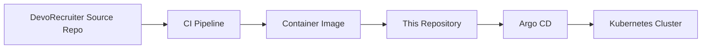

# DevoRecruiter GitOps

This repository defines the desired Kubernetes state for DevoRecruiter and
contains local tooling for controlled infrastructure operations.

It is intentionally separate from the application source monorepo so deployment changes can be reviewed, promoted, and rolled out independently from application code.

## Architecture

## Scope

This repository should contain:

- Helm charts
- environment values
- Argo CD project definitions
- Argo CD application definitions
- exact Docker image SHA references
- the local MCP infrastructure server and operational documentation

This repository must not contain:

- application source code
- Dockerfiles
- CI build logic
- cloud credentials
- Kubernetes Secret values
- kubeconfig files
- Terraform state
- local runtime data

## Repository Layout

- `charts/` reusable or application charts
- `environments/` environment-specific values and overlays
- `argocd/` Argo CD project and application definitions
- `tools/mcp-infra/` TypeScript MCP server for GitOps, K3s, Argo CD, Terraform, and Dynatrace
- `monitoring/dynatrace/` monitoring configuration examples
- `local-demo/` local cluster demonstration assets
- `docs/final-report/` implementation and validation records

## Deployment Flow

1. The application repository builds and tests the software.
2. The image is published with an immutable tag.
3. This repository is updated with the new tag or release reference.
4. Argo CD reconciles the cluster state to match Git.

## Branching and Commits

- Use branches such as `feat/<area>`, `fix/<area>`, `docs/<area>`, or `gitops/<area>`
- Keep commit messages short and descriptive
- Prefer Conventional Commits such as `chore(gitops): update image reference`
- Avoid mixing infrastructure policy changes with unrelated app changes

## Contributing

- Update only the deployment state you intend to change
- Keep secrets outside Git
- Document rollout risk when a manifest change may affect availability

## Helm Charts

The development charts are:

- `charts/frontend`: Angular frontend served by nginx on port 80.
- `charts/api-bff`: NestJS BFF API served on port 3000.
- `charts/api-back`: FastAPI RAG service served on port 8000.
- `charts/n8n`: workflow automation service.
- `charts/postgres`: PostgreSQL database.

The development values enable ingress for the frontend and n8n and local-path
persistent volumes for stateful services on the single-node K3s host.

## Secret Handling

Secrets are intentionally not stored in this repository. Charts reference externally-created Kubernetes Secrets such as:

- `devorecruiter-api-bff-secrets`
- `devorecruiter-api-back-secrets`

Create these Secrets outside Git before syncing the applications. The repository
contains names and keys only, never secret values.

## MCP infrastructure server

[`tools/mcp-infra/README.md`](tools/mcp-infra/README.md) documents the 45 tools,
resources, prompts, safety gates, and local STDIO setup. The server is read-only
by default; changes require explicit configuration and confirmation.

From `tools/mcp-infra/`, run `npm ci`, `npm run typecheck`, `npm run build`, and
`npm test` to validate the server locally. The live validation scripts require
access to a configured cluster or Azure VM and are separate from the unit tests.

The [final report](docs/final-report/09-testing-and-evidence.md) records
historical infrastructure and cluster checks. It does not establish current
cloud availability. Azure resource definitions live in the source monorepo's
`infrastructure/terraform/` directory; this GitOps repository does not apply
Terraform automatically.
