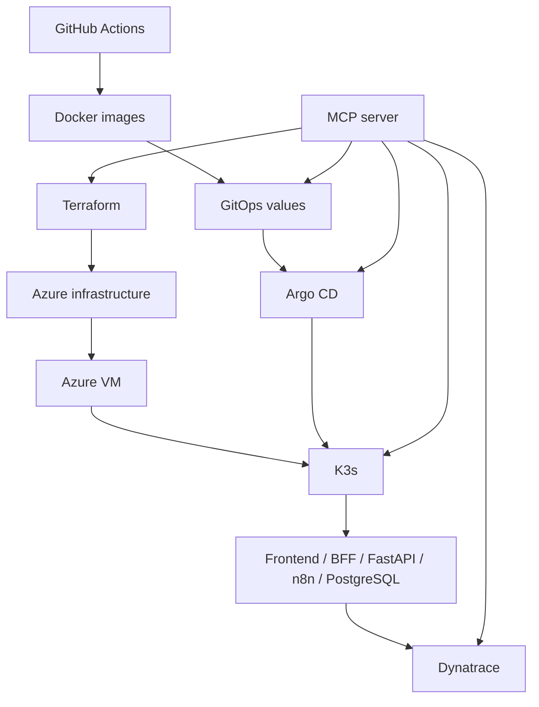

# Project Architecture

Terraform owns Azure infrastructure only. GitOps owns Kubernetes desired state. Argo CD synchronizes Git to K3s. Dynatrace observes infrastructure, Kubernetes, and applications. MCP exposes controlled READ, PLAN, WRITE, and DESTRUCTIVE operations.
