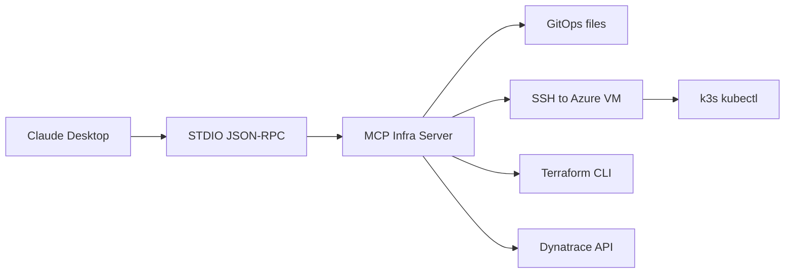

# MCP Implementation

MCP server location:

```text
devorecruiter-gitops/tools/mcp-infra
```

Status: `IMPLEMENTED`.

Implemented domains:

- GitOps tools;
- Kubernetes read tools through SSH;
- Argo CD read and guarded sync tools;
- Terraform read, plan, guarded apply, and disabled-by-default destroy tools;
- Dynatrace read and plan preview tools;
- resources;
- prompts;
- audit logging;
- exact confirmation checks;
- destructive mode gate.

Architecture:



The server never accepts arbitrary Terraform commands.
