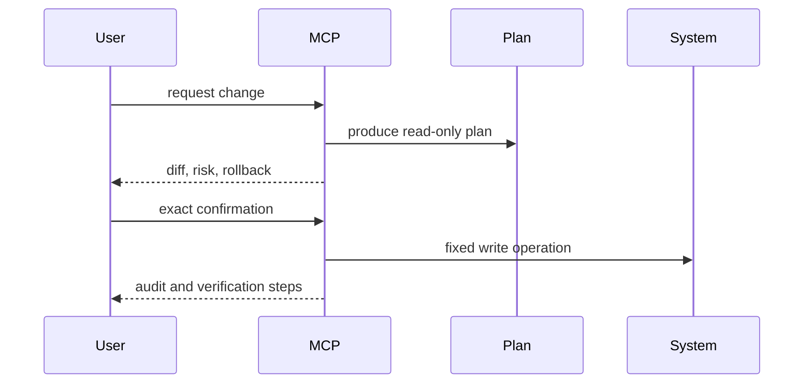

# Security Model

Principles:

- Git is the source of truth for persistent Kubernetes changes.
- Terraform writes require saved plans.
- Destructive Terraform operations require `MCP_INFRA_ENABLE_MUTATIONS=true`, `MCP_INFRA_ENABLE_DESTRUCTIVE=true`, and exact confirmation.
- Kubernetes access is namespace-restricted.
- Argo CD access is project-restricted.
- Dynatrace tokens come from local environment only.
- Secrets are not committed, printed, or documented.

Write flow:

