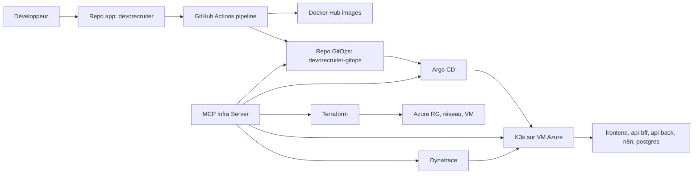
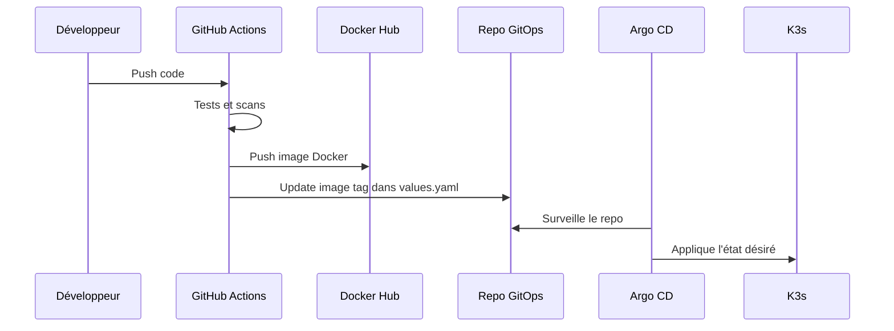

# Audit Complet DevoRecruiter

Date d'audit: 2026-07-30

Statut global: `VERIFIED_WITH_LIMITATIONS`

Ce rapport explique tout le travail réalisé depuis la pipeline CI/CD jusqu'à Dynatrace, avec les concepts, les commandes, les workflows, les tests et les limites restantes. Il est écrit pour apprendre et comprendre, pas seulement pour cocher une checklist.

## 1. Résumé Exécutif

La plateforme DevoRecruiter repose maintenant sur ces briques:

| Domaine | Statut | Résultat |
| --- | --- | --- |
| Pipeline CI/CD | `IMPLEMENTED` | Workflow GitHub Actions complet avec tests, scans, builds Docker, publication d'images et mise à jour GitOps |
| Terraform Azure | `VERIFIED` | Ressources Azure existantes importées dans l'état Terraform local; `terraform plan` retourne `No changes` |
| K3s Kubernetes | `VERIFIED` | Cluster accessible par SSH; 5 pods applicatifs Running dans `devorecruiter-dev` |
| Argo CD / GitOps | `VERIFIED` | 5 applications Argo CD Healthy et Synced |
| Dynatrace Kubernetes | `VERIFIED` | Operator, DynaKube, ActiveGate, log monitoring, webhook et CSI driver Running |
| MCP Infra | `VERIFIED` | Serveur MCP TypeScript avec outils GitOps, Kubernetes, Argo CD, Terraform, Dynatrace; tests OK |
| Dynatrace MCP API | `LIMITED` | Le Platform Token marche pour `dtwiz` et l'ingestion, mais retourne `403` sur `/api/v2/problems` |

Point de sécurité important: un token Dynatrace a été collé dans le chat. Il faut le considérer exposé, le révoquer et le remplacer.

## 2. Architecture Globale



Séparation des responsabilités:

- Terraform gère l'infrastructure Azure: resource group, réseau, IP publique, NIC, NSG, VM.
- GitOps gère le déploiement Kubernetes: charts Helm, values, Argo CD Applications.
- Argo CD synchronise Git vers K3s.
- Dynatrace observe le cluster et les logs.
- MCP expose des outils contrôlés pour lire, diagnostiquer et planifier sans casser la plateforme.

## 3. Pipeline CI/CD

Fichier principal:

```text
D:\Stage DevoTeam\devorecruiter\.github\workflows\pipeline.yml
```

### Concept

Une pipeline CI/CD automatise:

1. la détection des parties modifiées;
2. les tests;
3. les scans de sécurité;
4. les builds Docker;
5. la publication d'images;
6. la mise à jour GitOps.

Le principe important: on ne déploie pas directement sur Kubernetes depuis la pipeline applicative. On publie une image, puis on modifie le repo GitOps. Ensuite Argo CD applique l'état Git sur Kubernetes.

### Workflow Implémenté

La pipeline contient ces familles de jobs:

| Job | Rôle |
| --- | --- |
| `detect-changes` | Détecte si `frontend`, `api-bff`, `api-back`, `n8n` ou `infrastructure` ont changé |
| `repository-secret-scan` | Lance Gitleaks pour détecter les secrets committés |
| `frontend-ci` | Installe, lint, typecheck, tests, build Angular, Docker build, smoke test |
| `frontend-security` | `npm audit` et Semgrep |
| `frontend-publish` | Build image release, scan Trivy, push Docker Hub |
| `bff-ci` | Tests NestJS/API BFF, build, Docker smoke test, smoke test PDF |
| `bff-security` | Audit npm et Semgrep |
| `bff-publish` | Build, scan et push image BFF |
| `fastapi-ci` | Installation Python, compile, import OpenAPI, startup uvicorn, Docker smoke test |
| `fastapi-security` | `pip-audit` et Semgrep |
| `fastapi-publish` | Build, scan et push image API back |
| `gitops-update` | Met à jour les tags d'image dans `devorecruiter-gitops` |
| `n8n-validation` | Valide les exports JSON n8n |
| `terraform-validation` | `terraform fmt`, `init`, `validate`, TFLint, Checkov, Trivy config, plan PR |

### Commandes CI Représentatives

Frontend:

```bash
npm ci
npm run lint:ci
npm run typecheck
npm run test:ci
npm run build
docker build -t devorecruiter-front:ci-local apps/frontend
curl --fail http://127.0.0.1:8080/healthz
curl --fail http://127.0.0.1:8080/readyz
```

BFF:

```bash
npm ci
npm test
npm run build
docker build -t devorecruiter-api-bff:ci-local apps/api-bff
curl --fail http://127.0.0.1:3000/healthz
curl --fail http://127.0.0.1:3000/readyz
```

FastAPI:

```bash
python -m pip install -r requirements.txt
python -m pip check
python -m compileall app
python -c "from app.main import app; paths = app.openapi()['paths']; assert '/healthz' in paths"
python -m uvicorn app.main:app --host 127.0.0.1 --port 8000
curl --fail http://127.0.0.1:8000/healthz
curl --fail http://127.0.0.1:8000/readyz
```

Terraform CI:

```bash
terraform -chdir=infrastructure/terraform fmt -check -recursive
terraform -chdir=infrastructure/terraform init -backend=false
terraform -chdir=infrastructure/terraform validate
tflint --init
tflint --recursive
checkov -d infrastructure/terraform --quiet
trivy config infrastructure/terraform
```

### Comment Tester La Pipeline

Depuis GitHub:

1. pousser une branche ou ouvrir une Pull Request vers `main`;
2. vérifier les jobs `*-ci`, `*-security` et `terraform-validation`;
3. sur `main`, vérifier la publication Docker Hub;
4. vérifier que `gitops-update` modifie les tags dans le repo GitOps;
5. vérifier que Argo CD détecte le changement et synchronise.

Statut actuel: la pipeline est implémentée localement. La preuve GitHub Actions en ligne reste à revoir dans l'interface GitHub.

## 4. Terraform Azure

Répertoire:

```text
D:\Stage DevoTeam\devorecruiter\infrastructure\terraform
```

### Concept

Terraform sert à décrire l'infrastructure comme du code. Au lieu de créer/modifier des ressources Azure manuellement, on définit l'état voulu dans des fichiers `.tf`.

Les trois commandes centrales:

```powershell
terraform init
terraform plan
terraform apply
```

Dans notre cas, on a été prudent: les ressources Azure existaient déjà. Donc l'objectif n'était pas de recréer, mais de les importer dans l'état Terraform et vérifier qu'il n'y a pas de drift.

### Ressources Modélisées

Terraform décrit l'existant:

| Ressource | Nom |
| --- | --- |
| Subscription | `Azure for Students` |
| Subscription ID | `acec6a34-0f38-4da1-9e5b-6335ff6efc80` |
| Tenant ID | `604f1a96-cbe8-43f8-abbf-f8eaf5d85730` |
| Resource group | `rg-devorecruiter-dev` |
| VM | `vm-devorecruiter-dev` |
| Public IP | `68.221.76.45` |
| Private IP | `10.0.0.4` |
| VNet | `vm-devorecruiter-devVNET` |
| Subnet | `vm-devorecruiter-devSubnet` |
| NSG | `vm-devorecruiter-devNSG` |
| NIC | `vm-devorecruiter-devVMNic` |

### Fichiers Terraform

| Fichier | Rôle |
| --- | --- |
| `versions.tf` | Version Terraform et providers requis |
| `providers.tf` | Provider AzureRM |
| `variables.tf` | Variables configurables |
| `locals.tf` | Valeurs calculées |
| `main.tf` | Ressources Azure |
| `outputs.tf` | Sorties utiles après plan/apply |
| `terraform.tfvars.example` | Exemple de configuration locale |
| `backend.azurerm.tf.example` | Exemple pour stocker le state dans Azure Blob |
| `.gitignore` | Empêche de committer state, plans et secrets |

### Protection Anti Accident

La variable:

```hcl
enable_infrastructure = false
```

sert de garde-fou. Par défaut, Terraform ne doit pas manipuler l'infrastructure tant qu'on n'a pas explicitement activé la gestion.

Pour planifier contre l'existant:

```powershell
$env:TF_VAR_enable_infrastructure="true"
$env:TF_VAR_subscription_id="acec6a34-0f38-4da1-9e5b-6335ff6efc80"
$env:TF_VAR_ssh_public_key=(Get-Content "C:\Users\Farah\.ssh\id_rsa.pub" -Raw).Trim()
terraform plan -input=false -no-color
```

Résultat vérifié:

```text
No changes. Your infrastructure matches the configuration.
```

Cela signifie que Terraform compare le code avec Azure et ne voit aucune modification à faire. C'est exactement ce qu'on veut après un import propre.

### Commandes De Test Exécutées

```powershell
Set-Location "D:\Stage DevoTeam\devorecruiter\infrastructure\terraform"
terraform validate -no-color
```

Résultat:

```text
Success! The configuration is valid.
```

Plan:

```powershell
$env:TF_VAR_enable_infrastructure="true"
$env:TF_VAR_subscription_id="acec6a34-0f38-4da1-9e5b-6335ff6efc80"
$env:TF_VAR_ssh_public_key=(Get-Content "C:\Users\Farah\.ssh\id_rsa.pub" -Raw).Trim()
terraform plan -input=false -no-color
```

Résultat:

```text
No changes. Your infrastructure matches the configuration.
```

### Pourquoi Ne Pas Faire `terraform apply` Maintenant

Parce que le plan dit qu'il n'y a rien à appliquer. Lancer `apply` n'apporterait aucune valeur. La bonne pratique est:

1. `validate`;
2. `plan`;
3. lire le plan;
4. appliquer seulement si le plan contient un changement voulu.

## 5. K3s Kubernetes

VM:

```text
azureuser@68.221.76.45
```

K3s est une distribution Kubernetes légère, adaptée à une petite VM. Elle permet d'avoir Kubernetes sans un cluster AKS complet.

### Commandes Utiles

Connexion:

```powershell
ssh azureuser@68.221.76.45
```

Lister les nodes:

```bash
sudo k3s kubectl get nodes -o wide
```

Lister les pods:

```bash
sudo k3s kubectl get pods -A -o wide
```

Lister les services applicatifs:

```bash
sudo k3s kubectl get svc -n devorecruiter-dev
```

### Validation Exécutée Via MCP

Commande:

```powershell
Set-Location "D:\Stage DevoTeam\devorecruiter-gitops\tools\mcp-infra"
npm run validate:live
```

Résultat vérifié:

```json
{
  "kubernetes": {
    "podCount": 5,
    "runningPods": 5,
    "serviceCount": 5
  }
}
```

Interprétation:

- 5 pods applicatifs existent;
- les 5 sont Running;
- 5 services Kubernetes existent;
- le namespace applicatif est opérationnel.

## 6. Helm, GitOps Et Argo CD

### Concept GitOps

GitOps veut dire: Git est la source de vérité.

Flux:



La pipeline ne fait pas `kubectl apply` directement. Elle met à jour GitOps, puis Argo CD déploie.

### Applications GitOps

Applications suivies:

- `frontend`
- `api-bff`
- `api-back`
- `n8n`
- `postgres`

### Validation Argo CD

Commande:

```powershell
Set-Location "D:\Stage DevoTeam\devorecruiter-gitops\tools\mcp-infra"
npm run validate:live
```

Résultat vérifié:

```json
{
  "argocd": {
    "appCount": 5,
    "healthyApps": 5,
    "syncedApps": 5,
    "dryRunSyncProtected": true
  }
}
```

Interprétation:

- Argo CD connaît 5 applications;
- les 5 sont `Healthy`;
- les 5 sont `Synced`;
- le MCP protège les opérations de sync en dry-run/contrôle par défaut.

## 7. MCP Infra

Répertoire:

```text
D:\Stage DevoTeam\devorecruiter-gitops\tools\mcp-infra
```

### Concept MCP

MCP signifie Model Context Protocol.

Dans ce projet, le MCP est un petit serveur TypeScript qui donne à un assistant IA des outils contrôlés pour interagir avec l'infrastructure.

Sans MCP, l'assistant doit exécuter des commandes shell libres. Avec MCP, on expose des outils métier plus sûrs:

- lire l'état GitOps;
- lire Kubernetes;
- lire Argo CD;
- lancer un plan Terraform;
- lire Dynatrace;
- refuser par défaut les actions destructives.

### Structure MCP

| Chemin | Rôle |
| --- | --- |
| `src/server.ts` | Enregistre outils, ressources et prompts |
| `src/config/environment.ts` | Lit la configuration `.env` |
| `src/clients/*.client.ts` | Clients GitOps, Kubernetes, Argo CD, Terraform, Dynatrace |
| `src/tools/*/*.tools.ts` | Outils exposés au MCP |
| `src/resources/infra.resources.ts` | Ressources lisibles par le client MCP |
| `src/prompts/infra.prompts.ts` | Prompts guidés pour diagnostic |
| `src/security/*.ts` | Permissions, audit, validations, confirmations |
| `scripts/validate-live-readonly.ts` | Test live read-only K3s/Argo/GitOps |
| `scripts/validate-dynatrace-readonly.ts` | Test live read-only Dynatrace |

### Scripts Disponibles

Dans `package.json`:

```json
{
  "dev": "tsx src/index.ts",
  "build": "npm run clean && tsc -p tsconfig.build.json",
  "typecheck": "tsc -p tsconfig.json --noEmit",
  "test": "vitest run",
  "validate:live": "tsx scripts/validate-live-readonly.ts",
  "validate:dynatrace": "tsx scripts/validate-dynatrace-readonly.ts",
  "install:dynatrace-operator": "tsx scripts/install-dynatrace-operator.ts"
}
```

### Outils MCP Ajoutés

GitOps:

- lire les images déployées;
- inspecter les manifests;
- préparer des updates d'image;
- protéger les écritures.

Kubernetes:

- lister pods/services/namespaces;
- lire l'état du cluster via SSH;
- vérifier les workloads.

Argo CD:

- lister applications;
- vérifier `Healthy` et `Synced`;
- empêcher une sync réelle non confirmée.

Terraform:

- `terraform_version`
- `terraform_status`
- `terraform_validate`
- `terraform_show_state_summary`
- `terraform_outputs`
- `list_managed_resources`
- `terraform_plan`
- `terraform_plan_destroy`
- `terraform_show_plan`
- `terraform_estimate_changes`
- `terraform_apply_saved_plan`
- `terraform_destroy`

Dynatrace:

- `dynatrace_connection_status`
- `list_dynatrace_problems`
- `get_dynatrace_problem`
- `query_dynatrace_metrics`
- `get_kubernetes_health`
- `get_service_health`
- `get_host_health`
- `get_recent_alerts`
- `plan_monitoring_configuration`
- `preview_alert_configuration`
- `preview_dashboard_configuration`

### Modèle De Sécurité MCP

Le MCP sépare les opérations en familles:

| Type | Exemple | Risque | Protection |
| --- | --- | --- | --- |
| READ | lister pods | faible | autorisé |
| PLAN | `terraform plan` | faible/moyen | autorisé sans apply |
| WRITE | update GitOps | moyen | mutations désactivées par défaut |
| DESTRUCTIVE | destroy Terraform | élevé | double flag + confirmation exacte |

Flags importants:

```env
MCP_INFRA_ENABLE_MUTATIONS=false
MCP_INFRA_ENABLE_DESTRUCTIVE=false
```

Une action destructive doit avoir:

```text
MCP_INFRA_ENABLE_MUTATIONS=true
MCP_INFRA_ENABLE_DESTRUCTIVE=true
confirmation exacte
```

Ce design évite qu'un assistant, un script ou une erreur lance une suppression accidentelle.

### Tests MCP Exécutés

Typecheck:

```powershell
npm run typecheck
```

Résultat:

```text
tsc -p tsconfig.json --noEmit
```

Tests:

```powershell
npm test
```

Résultat:

```text
Test Files  2 passed (2)
Tests       17 passed (17)
```

Validation live:

```powershell
npm run validate:live
```

Résultat clé:

```json
{
  "server": {
    "version": "0.3.0",
    "status": "initialized",
    "mutationsEnabled": false
  },
  "gitops": {
    "imageCount": 5
  },
  "kubernetes": {
    "podCount": 5,
    "runningPods": 5
  },
  "argocd": {
    "appCount": 5,
    "healthyApps": 5,
    "syncedApps": 5
  }
}
```

### Comment Le MCP Travaille En Interne

Exemple pour Kubernetes:

1. le client MCP appelle un outil comme `get_kubernetes_health`;
2. le serveur MCP lit la config `.env`;
3. il ouvre une connexion SSH vers la VM Azure;
4. il exécute une commande contrôlée, par exemple `sudo k3s kubectl get pods`;
5. il parse/synthétise la sortie;
6. il retourne un JSON lisible.

Exemple pour Terraform:

1. le client MCP appelle `terraform_plan`;
2. le MCP exécute Terraform dans le dossier autorisé;
3. il capture stdout/stderr/exit code;
4. il refuse les opérations destructives sans confirmation;
5. il peut afficher un résumé du plan.

## 8. Dynatrace

### Concept

Dynatrace observe l'infrastructure, Kubernetes et les applications.

Sur Kubernetes, Dynatrace utilise:

- un Operator;
- une Custom Resource `DynaKube`;
- ActiveGate pour collecter et router les données;
- CSI driver pour l'injection OneAgent;
- log monitoring pour envoyer les logs;
- webhooks pour enrichir/injecter selon configuration.

### Première Tentative Et Problème

Une tentative manuelle avait échoué:

```bash
kubectl create namespace dynatrace
kubectl -n dynatrace create secret generic dynakube ...
helm install dynatrace-operator ...
kubectl apply -f monitoring/dynatrace/dynakube.yaml
```

Erreurs observées:

```text
error: exactly one NAME is required, got 2
Command 'helm' not found
error: the path "monitoring/dynatrace/dynakube.yaml" does not exist
```

Ca voulait dire:

- le secret avait été appelé avec `...` au lieu de vrais paramètres;
- Helm n'était pas installé sur la VM;
- le fichier YAML n'existait pas à cet endroit sur la VM;
- le cluster n'avait pas encore de DynaKube utilisable.

### Installation Operator

Helm a été installé sur la VM.

Vérification:

```bash
helm version
```

Résultat:

```text
v4.2.3
```

Installation Operator:

```bash
sudo env KUBECONFIG=/etc/rancher/k3s/k3s.yaml helm install dynatrace-operator \
  oci://public.ecr.aws/dynatrace/dynatrace-operator \
  --create-namespace \
  --namespace dynatrace \
  --atomic
```

Ensuite, `dtwiz` a été utilisé pour générer et appliquer la configuration Dynatrace Kubernetes à partir du tenant Dynatrace.

Commande conceptuelle:

```powershell
$env:DT_ENVIRONMENT="https://zma72433.apps.dynatrace.com"
$env:DT_PLATFORM_TOKEN="<REDACTED>"
dtwiz install kubernetes
```

Côté VM, le cluster réel K3s a été ciblé avec:

```bash
sudo env KUBECONFIG=/etc/rancher/k3s/k3s.yaml \
  DT_ENVIRONMENT="https://zma72433.apps.dynatrace.com" \
  DT_PLATFORM_TOKEN="<REDACTED>" \
  /tmp/dtwiz-install/dtwiz install kubernetes -y
```

### Problème De Capacité VM

La VM Azure Students est petite:

```text
2 vCPU
environ 4 GiB RAM
```

Le profil Dynatrace généré par défaut était trop lourd:

- plusieurs ActiveGate;
- requests mémoire de 2 Gi à 6 Gi;
- telemetry/OTel;
- extensions;
- logs;
- app monitoring.

Symptômes:

```text
0/1 nodes are available: Insufficient cpu, Insufficient memory
CrashLoopBackOff
Liveness probe failed
TLS handshake timeout
```

Correction:

- réduire les replicas ActiveGate;
- réduire les requests CPU/mémoire;
- désactiver l'OTel collector qui crashait;
- consolider en un seul DynaKube `default-agents`;
- garder Kubernetes monitoring + routing/log monitoring dans un profil plus léger.

### Etat Final Dynatrace

Commande:

```bash
sudo k3s kubectl -n dynatrace get dynakube,pods -o wide
```

Résultat vérifié:

```text
dynakube.dynatrace.com/default-agents   Running
default-agents-activegate-0             1/1 Running
default-agents-logmonitoring-...        1/1 Running
dynatrace-oneagent-csi-driver-...       4/4 Running
dynatrace-operator-...                  1/1 Running
dynatrace-webhook-...                   1/1 Running
```

Validation MCP:

```powershell
npm run validate:dynatrace
```

Résultat clé:

```json
{
  "clusterEvidence": {
    "namespaceFound": true,
    "crdFound": true,
    "podFound": true,
    "dynakubesRunning": true,
    "dynakubeSecretsFound": true
  }
}
```

Validation tenant via `dtwiz watch`:

```text
Logs ingested
```

Interprétation:

- Dynatrace reçoit déjà des logs;
- le lien tenant/cluster fonctionne;
- le DynaKube est opérationnel;
- l'installation est adaptée à la petite VM.

### Limite Dynatrace Restante

Le token fourni est un Platform Token. Il marche pour `dtwiz`, mais il retourne:

```text
403 Forbidden
```

sur:

```text
https://zma72433.live.dynatrace.com/api/v2/problems
```

Donc:

- Dynatrace Kubernetes fonctionne;
- l'ingestion fonctionne;
- mais les outils MCP `problems/metrics` ont besoin soit d'un token API classique avec les bons scopes, soit d'une migration vers les APIs Platform adaptées.

### Action Sécurité Obligatoire

Comme le token a été collé dans le chat:

1. créer un nouveau token dans Dynatrace;
2. mettre à jour le secret Kubernetes `dynatrace/default`;
3. révoquer l'ancien token;
4. vérifier que `DynaKube default-agents` reste `Running`.

Commande de vérification après rotation:

```bash
sudo k3s kubectl -n dynatrace get dynakube,pods
```

## 9. Commandes De Runbook

### Terraform

```powershell
Set-Location "D:\Stage DevoTeam\devorecruiter\infrastructure\terraform"
terraform validate -no-color

$env:TF_VAR_enable_infrastructure="true"
$env:TF_VAR_subscription_id="acec6a34-0f38-4da1-9e5b-6335ff6efc80"
$env:TF_VAR_ssh_public_key=(Get-Content "C:\Users\Farah\.ssh\id_rsa.pub" -Raw).Trim()
terraform plan -input=false -no-color
```

Résultat attendu:

```text
Success! The configuration is valid.
No changes. Your infrastructure matches the configuration.
```

### MCP

```powershell
Set-Location "D:\Stage DevoTeam\devorecruiter-gitops\tools\mcp-infra"
npm run typecheck
npm test
npm run validate:live
npm run validate:dynatrace
```

Résultat attendu:

```text
Tests passed
Kubernetes runningPods = 5
Argo healthyApps = 5
Argo syncedApps = 5
Dynatrace dynakubesRunning = true
```

### Kubernetes

```powershell
ssh azureuser@68.221.76.45
```

Puis:

```bash
sudo k3s kubectl get nodes -o wide
sudo k3s kubectl get pods -A -o wide
sudo k3s kubectl get svc -n devorecruiter-dev
sudo k3s kubectl -n dynatrace get dynakube,pods -o wide
```

### Argo CD

Via MCP:

```powershell
npm run validate:live
```

Ou côté cluster:

```bash
sudo k3s kubectl get applications -n argocd
```

Résultat attendu:

```text
Healthy
Synced
```

### Dynatrace

```powershell
dtwiz status
dtwiz watch --from "now()-30m"
```

Résultat attendu:

```text
Platform Token: valid
Logs ingested
```

## 10. Comment Chaque Partie Marche Ensemble

### Quand Tu Push Du Code

1. GitHub Actions détecte le changement.
2. Le job concerné teste l'application.
3. Les scanners vérifient secrets, dépendances, code, image.
4. L'image Docker est buildée et poussée.
5. `gitops-update` modifie le tag d'image dans le repo GitOps.
6. Argo CD voit le commit GitOps.
7. Argo CD synchronise K3s.
8. Dynatrace observe les logs et composants Kubernetes.

### Quand Tu Changes L'Infra

1. Tu modifies Terraform.
2. Tu lances `terraform validate`.
3. Tu lances `terraform plan`.
4. Tu lis le plan.
5. Tu appliques seulement si le changement est voulu.
6. Le MCP peut aider à lire ou expliquer le plan.

### Quand Tu Diagnostiques

1. MCP lit GitOps pour savoir ce qui devrait tourner.
2. MCP lit Kubernetes pour savoir ce qui tourne vraiment.
3. MCP lit Argo CD pour savoir si Git et cluster sont synchronisés.
4. MCP lit Terraform pour savoir si Azure correspond au code.
5. MCP lit Dynatrace, sous réserve d'un token API compatible, pour problèmes/métriques.

## 11. Preuves D'Audit

### Terraform

```text
terraform validate -no-color
Success! The configuration is valid.
```

```text
terraform plan -input=false -no-color
No changes. Your infrastructure matches the configuration.
```

### MCP

```text
npm run typecheck
OK
```

```text
npm test
Test Files  2 passed (2)
Tests       17 passed (17)
```

### Live K3s / Argo CD

```json
{
  "server": {
    "version": "0.3.0",
    "status": "initialized",
    "mutationsEnabled": false
  },
  "gitops": {
    "imageCount": 5
  },
  "kubernetes": {
    "podCount": 5,
    "runningPods": 5,
    "serviceCount": 5
  },
  "argocd": {
    "appCount": 5,
    "healthyApps": 5,
    "syncedApps": 5,
    "dryRunSyncProtected": true
  }
}
```

### Dynatrace

```json
{
  "clusterEvidence": {
    "namespaceFound": true,
    "crdFound": true,
    "podFound": true,
    "dynakubesRunning": true,
    "dynakubeSecretsFound": true
  }
}
```

```text
dtwiz watch
Logs ingested
```

## 12. Limites Et Risques

| Risque | Niveau | Explication | Action |
| --- | --- | --- | --- |
| Token Dynatrace exposé dans le chat | Élevé | Le token a été visible hors d'un secret manager | Le révoquer et le remplacer |
| MCP Dynatrace API classique limité | Moyen | Platform Token retourne `403` sur API v2 problems | Créer un API token scoped ou migrer MCP vers Platform APIs |
| VM Azure Students petite | Moyen | 2 vCPU / 4 GiB RAM limite Dynatrace full-stack complet | Garder profil léger ou augmenter taille VM |
| CI GitHub non observée après changements | Moyen | Pipeline écrite mais run GitHub final à confirmer | Ouvrir Actions et valider les runs |
| Terraform state local | Moyen | State local acceptable pour apprentissage mais pas prod | Migrer vers Azure Blob backend |
| Secrets GitHub à confirmer | Moyen | DockerHub, GitOps deploy key, Azure creds doivent être présents | Vérifier GitHub Secrets |

## 13. Ce Qui Reste A Faire

Priorité 1:

1. révoquer le token Dynatrace exposé;
2. créer un nouveau token;
3. mettre à jour le secret Kubernetes;
4. vérifier `DynaKube default-agents Running`.

Priorité 2:

1. créer un API token Dynatrace classique avec scopes nécessaires pour problems/metrics;
2. l'ajouter localement dans le `.env` MCP;
3. relancer les outils MCP Dynatrace.

Priorité 3:

1. vérifier un vrai run GitHub Actions;
2. vérifier publication Docker Hub;
3. vérifier commit automatique GitOps;
4. vérifier Argo CD après changement d'image.

Priorité 4:

1. migrer Terraform state vers Azure Blob;
2. configurer backend remote;
3. documenter la procédure de `terraform init -migrate-state`.

## 14. Conclusion

Le travail réalisé couvre toute la chaîne Platform Engineering:

- CI/CD applicative;
- DevSecOps avec scans et smoke tests;
- Infrastructure as Code avec Terraform;
- GitOps avec Argo CD;
- Kubernetes K3s sur Azure VM;
- Observability avec Dynatrace;
- MCP pour l'exploitation contrôlée par outils.

La plateforme est fonctionnelle avec limitations connues. Les points les plus importants à retenir:

- Terraform ne remplace pas GitOps: Terraform gère Azure, GitOps gère Kubernetes.
- La pipeline ne déploie pas directement: elle publie une image et met à jour GitOps.
- Argo CD applique Git vers K3s.
- Dynatrace observe le cluster, mais doit être dimensionné selon la VM.
- MCP est une couche de contrôle: il rend l'exploitation plus structurée et moins dangereuse.

Statut final: `VERIFIED_WITH_LIMITATIONS`.

